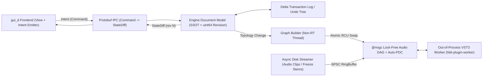
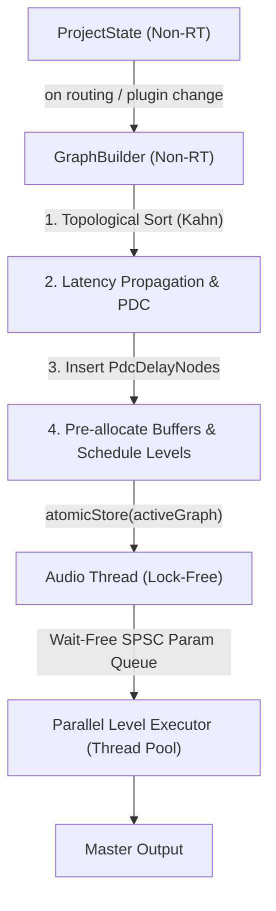

# Hibiki DAW v2 Architecture & Phased Engineering Roadmap

> **Goal**: Evolve Hibiki from a feature-rich prototype (`d_v2`) into a rock-solid, low-latency, production-grade DAW by adopting proven architectural patterns from open-source DAWs (**Tracktion Engine**, **Ardour**, and **Zrythm**) while leaning into Hibiki's unique strengths: `@nogc` / `-betterC` D real-time DSP, out-of-process VST3 plugin sandboxing, and Protobuf client/engine separation.

---

## 1. Current Baseline & Architectural Comparison

### 1.1 What Hibiki Already Does Well
Compared with many open-source DAWs, Hibiki already has strong architectural foundations documented in [`docs/d_v2.md`](d_v2.md):
- **Out-of-process VST3 sandboxing** (`engine/plugin/plugin_proxy*`, `hbk-plugin-worker`) with offscreen remote GUI framebuffer streaming — a plugin crash cannot take down the DAW host.
- **D-language real-time DSP (`@nogc`, `-betterC`)** for built-in instruments and effects (`engine/instruments/builtin_sylph.d`, `builtin_3xosc.d`, `builtin_acid_bass.d`, `builtin_dr8_*.d`, `engine/effects/`), avoiding C++ UB and GC pauses on the audio thread.
- **Clean Protobuf IPC boundary** (`pb/core.proto`, `pb/commands.proto`, `pb/notifications.proto`, `pb/plugin_worker.proto`) separating the `hbk-play` audio engine from frontends (`gui_d`, Java Swing, CLI/SDK).
- **Unified live & offline rendering** (`RenderProjectAudioBlock`) with Kahn topological bus sorting and cycle rejection (`WouldCreateRoutingCycle`).

### 1.2 Gap Analysis vs. Tracktion Engine, Ardour & Zrythm

| Dimension | Tracktion Engine / Ardour / Zrythm | Current Hibiki (`d_v2`) | V2 Target |
| :--- | :--- | :--- | :--- |
| **State Authority** | Single document model (`te::Edit` / `juce::ValueTree`) driving all views | Dual state in `gui_d/transport_model.d` + `engine/core/project.hpp` (prone to sync drift) | **Phase 1**: Engine Single Source of Truth (SSOT) + revisioned `StateDiff` |
| **Undo / Redo** | Reversible transaction deltas (`ValueTree` / command inverses) | Full `ProjectState` Protobuf snapshots (`HistoryManager`, max 50, 36 `pushState` sites) | **Phase 2**: Staged Delta Transaction Log + Undo Tree (coalesced, O(1)) |
| **Audio Graph & RT Safety** | Lock-free DAG (`tracktion::graph`) swapped via atomic RCU, multi-core pool | Mutex-guarded (`tracks_mutex`) linear/topological loop in `playback_thread.cpp` | **Phase 3**: `@nogc` D Lock-Free Audio DAG + multi-core execution |
| **Latency Compensation (PDC)** | Automatic graph-wide PDC across buses, sends, and sidechains | No automatic delay-line compensation | **Phase 3**: Automatic topological PDC (`PdcDelayNode`) |
| **Time & Audio Clips** | Typed `BeatPos`/`SamplePos`, `TempoSequence`, mmap streaming, real-time Warp | Fixed BPM (`beatsToSec`), full-WAV RAM load, no real-time time-stretch | **Phase 4**: `TempoSequence`, disk streaming, non-destructive Warp |
| **Modulation & Automation** | DAW-wide `Modifier` nodes (LFO/Env/Step) + sample-accurate automation | Per-track `ModulatorD` (3 LFO slots), block-rate automation | **Phase 5**: Global cross-track Modifiers + per-sample `ParamRamp` + clip automation |
| **CPU Relief** | Reversible Track Freeze / Bounce in Place | Full project WAV bounce + basic clip bounce | **Phase 6**: Reversible Track Freeze / Unfreeze & Stem Bounce |

---

## 2. Target V2 System Architecture



### Core Design Invariants
1. **Engine is the sole authority for project state**: GUI widgets emit intents and render confirmed state (with lightweight ephemeral drag previews only while a mouse button is held).
2. **Audio thread never blocks, allocates, or touches disk**: All graph construction, plugin loading, file I/O, and Undo serialization occur strictly on non-RT threads.
3. **Every `DeltaOp` is mechanically testable**: `apply(op) -> undo(op)` must satisfy strict round-trip identity on the document model.
4. **Incremental, rollbackable delivery**: Each phase ships behind green Bazel tests (`bazel test //... -c opt`) with clean phase commits.

---

## 3. Phase 1 — Single Source of Truth (SSOT) & Revisioned State Sync

### 3.1 Problem Statement
Today, `gui_d/transport_model.d` mutates local structs (`channels`, `patterns`, `tracks`, `clips`, `plugins`) optimistically before or alongside IPC requests, while `engine/core/project.hpp` maintains its own authoritative `ProjectState`. Any mismatch in defaults, clip indices, pattern selection, or parameter initialization causes subtle UI-vs-audio desynchronization bugs.

### 3.2 Design
- **Monotonic Revision Counter**: Add `uint64_t state_revision` to `ProjectState` (`engine/core/project.hpp`), incremented on every committed command or Undo/Redo.
- **Explicit `StateDiff` / Snapshot Protocol (`pb/notifications.proto`)**:
  - Introduce a `StateSync` notification carrying `uint64 revision`, `bool is_full_snapshot`, and granular entity updates (`TrackDiff`, `ChannelDiff`, `PatternDiff`, `ClipDiff`, `PluginParamDiff`).
  - If `gui_d` observes a gap (`incoming.revision != last_applied_revision + 1`), it automatically requests a full `ProjectSnapshot` resync instead of silently diverging.
- **Eliminate Local-Only Mutations in `gui_d`**:
  - Remove hardcoded default templates/placeholders in `gui_d/transport_model.d` (`makeDefaultPluginSlot` dummy parameters, speculative clip/pattern index guesses).
  - Keep ephemeral drag state strictly inside widget interaction structs (e.g., `dragPreviewX`, `activeDragParamId`) and commit to `TransportModel` from Engine `StateDiff` responses.
- **Stable Entity IDs**:
  - Introduce monotonically allocated `uint64 id` fields (`track_id`, `clip_id`, `plugin_id`, `pattern_id`) alongside legacy indices so moving/deleting items never invalidates references in GUI or Undo history.

### 3.3 Key Touchpoints
- `pb/core.proto`, `pb/notifications.proto` (revision + stable IDs + `StateDiff`)
- `engine/core/project.hpp`, `engine/commands/*.cpp`, `engine/commands/dispatcher.d`
- `gui_d/transport_model.d`, `gui_d/main.d`, `gui_d/ipc_client.d`

### 3.4 Verification
- Add an E2E state-parity test (`gui_d/e2e_ipc_test.d`) that executes a sequence of channel, pattern, clip, mixer, and plugin mutations and asserts `gui_d`'s `TransportModel` matches `hbk-play`'s serialized `ProjectState` at every revision.

---

## 4. Phase 2 — Staged Delta Transaction Log & Undo Tree

### 4.1 Problem Statement
`HistoryManager` (`engine/core/history.hpp`, `engine/core/history.cpp`, `engine/core/history.d`) currently stores up to 50 full serialized `ProjectState` snapshots (`history.pushState(CaptureProjectState(state))` across 36 call sites in `engine/commands/`). Undoing a single knob tweak restores the entire project, risking audio dropouts, high memory usage with VST3 state chunks, and loss of alternate branches after `redo_stack_.clear()`.

### 4.2 Data Model (`pb/history.proto`)
Design a tree-capable **Delta Transaction Log** from the start (array of nodes indexed by `node_id` with `parent_id` and `current_node_id`, identical in spirit to Emacs `undo-tree`):

```protobuf
syntax = "proto3";
package hibiki.pb.history;

message DeltaOp {
  oneof op {
    SetPluginParamDelta set_plugin_param = 1;
    SetTrackPropDelta set_track_prop = 2;       // volume, pan, mute, solo, EQ, routing
    MidiNoteDelta midi_note = 3;                // add/remove/update note batch
    StepSequencerDelta step_seq = 4;            // step toggle, velocity, pitch, pan, shift
    ClipTransformDelta clip_transform = 5;      // move, resize, trim, gain
    AutomationPointDelta automation_point = 6;  // add/remove/move breakpoint
    TrackEntityDelta track_entity = 7;          // insert/remove single TrackState
    PluginEntityDelta plugin_entity = 8;        // insert/remove single PluginState + chunk
    ClipEntityDelta clip_entity = 9;            // insert/remove single TimelineClip
    bytes full_snapshot_fallback = 99;          // temporary bridge during incremental migration
  }
}

message UndoTransaction {
  uint64 node_id = 1;
  uint64 parent_id = 2;
  string label = 3;           // e.g. "Sylph Cutoff", "Move 4 Notes"
  int64 timestamp_ms = 4;
  string coalesce_key = 5;    // e.g. "param:100:0:9" for continuous drag merging
  repeated DeltaOp ops = 6;
}
```

### 4.3 Incremental 3-Step Migration (Zero Risk)
1. **Phase 2a — Transaction & Tree Container (`engine/core/history.d`, `pb/history.proto`)**:
   - Upgrade `HistoryManagerD` to store `UndoTransaction[] nodes`, `currentNodeId`, and per-node `childrenIds`.
   - Support **Coalescing**: if a new transaction arrives within a short window (e.g. `<= 400 ms`) with the same `coalesce_key` (e.g., continuous knob drag), preserve `old_value` and overwrite `new_value` in place.
   - Route all 36 existing `pushState` sites through `full_snapshot_fallback` initially so all existing tests remain green.
2. **Phase 2b — High-Frequency Pure Deltas**:
   - Migrate the highest-frequency mutations to true `(before, after)` `DeltaOp`s:
     1. Plugin parameters (`plugin_commands.cpp`) and Mixer faders/pan/EQ/mute/solo (`track_commands.cpp`).
     2. Piano Roll notes (`midi_commands.cpp`) and Step Sequencer edits (`sequencer_commands.cpp`).
     3. Timeline clip moves/resizes and automation points (`automation_commands.cpp`).
   - Undo/Redo applies only the affected delta directly — **zero audio interruption, O(1) latency**.
3. **Phase 2c — Entity-Scoped Structural Deltas & Fallback Removal**:
   - Migrate Track/Plugin/Clip add & delete commands to `TrackEntityDelta`, `PluginEntityDelta`, and `ClipEntityDelta` (embedding only the deleted entity's serialized state).
   - Remove `full_snapshot_fallback`, expose history list/branch switching over IPC, and optionally persist history in `.hbk` projects.

### 4.4 Verification
- Mandatory **round-trip property test** per `DeltaOp` variant in `engine/commands/commands_test.cc` and `engine/core/core_d_test.d`:
  `state_before -> apply(tx) -> undo(tx) == state_before` and `redo(tx) == state_after`.
- Verify drag coalescing merges 50 rapid parameter events into 1 `UndoTransaction` with exact initial `old_value` and final `new_value`.

---

## 5. Phase 3 — Lock-Free Multi-Threaded Audio DAG & Automatic PDC

### 5.1 Problem Statement
`engine/playback_thread.cpp` currently acquires `tracks_mutex` during `RenderProjectAudioBlock` and executes tracks sequentially on a single audio thread without compensating for plugin latency. Under heavy synth/FX loads or lookahead limiters/oversampled EQs, this risks mutex contention (xruns), underutilized CPU cores, and phase cancellation on parallel/sidechain paths.

### 5.2 Architecture (Inspired by `tracktion::graph` & Ardour)
Split audio execution into two strictly isolated layers in D (`@nogc`, `-betterC` compatible):



1. **Immutable Compiled `AudioGraph` (`engine/audio/graph.d`)**:
   - Granular `@nogc` node types: `GeneratorNode`, `AudioStreamNode`, `PluginNode`, `GainPanEqNode`, `SumBusNode`, `PdcDelayNode`, `MeterTapNode`.
   - All intermediate stereo scratch buffers are pre-allocated once by `GraphBuilder` when compiling a new graph — **zero allocation on the audio thread**.
   - Swapped into `PlaybackThread` via an atomic pointer (RCU); retired graphs are reclaimed safely on a background garbage/reaper thread after the audio callback completes its cycle.
2. **Wait-Free Control Queue**:
   - Parameter updates, transport commands, and live MIDI notes flow from IPC/UI threads into the audio thread via a lock-free SPSC ring buffer (`engine/audio/ring_buffer.d`), eliminating `tracks_mutex` / `plugins_mutex` from the real-time callback.
3. **Automatic Plugin Delay Compensation (PDC)**:
   - Extend `IPlugin` (`engine/plugin/iplugin.hpp`) with `virtual int getLatencySamples() const { return 0; }` (wired to VST3 `IAudioProcessor::getLatencySamples()` and built-in lookahead devices like `BuiltinLimiter` / `BuiltinMaxim` / `BuiltinConvolver`).
   - During graph compilation:
     1. Compute `arrival_latency[u]` for every node `u` in topological order:
        `arrival_latency[v] = max_{u -> v}(arrival_latency[u] + node_latency[u])`.
     2. For every incoming edge `u -> v` where `delta = arrival_latency[v] - (arrival_latency[u] + node_latency[u]) > 0`, insert a fixed-ring `PdcDelayNode(delta)` on that edge (including sidechain inputs and aux sends).
4. **Multi-Core Parallel Execution**:
   - Partition the DAG into dependency levels (or ready-count atomic work queue). Independent track chains run concurrently across a dedicated RT worker thread pool, joining cleanly before downstream bus `SumBusNode`s.

### 5.3 Verification
- **PDC Phase-Cancellation Test**: Route an impulse through two parallel buses (Bus A: dry, Bus B: mock plugin reporting `N = 256` samples latency and delaying output by `256` samples), invert Bus B, sum to Master, and assert peak residual `< 1e-6`.
- **RT-Safety Audit**: Compile `engine/audio/graph.d` with `-betterC` / `@nogc` so any accidental heap allocation fails at compile time.
- **Stress Benchmark**: Extend `engine/benchmark/` to compare single-threaded vs. multi-threaded DAG throughput on a 32-track / 64-plugin synthetic project.

---

## 6. Phase 4 — Musical Time (`TempoSequence`), Disk Streaming & Time-Stretching

### 6.1 Problem Statement
- Time conversion currently relies on a single scalar `ProjectState::bpm` (`beatsToSec`), preventing mid-song tempo ramps or time-signature changes.
- `AudioFile` loads entire WAV files into RAM, which does not scale to multi-track vocal/stem recordings.
- Audio clips cannot automatically conform to project tempo changes or be pitched independently of duration.

### 6.2 Design
1. **Strong Time Types & `TempoSequence` (`engine/core/tempo_sequence.d`)**:
   - Define distinct value types (`BeatPos`, `BeatDuration`, `SamplePos`, `Seconds`) to prevent unit-confusion bugs at compile time.
   - `TempoSequence` stores ordered `TempoEvent { BeatPos beat; double bpm; bool is_ramp; }` and `TimeSigEvent { BeatPos beat; int num; int denom; }` with O(log N) binary search for exact `beatToSample()` / `sampleToBeat()` conversion across linear tempo ramps.
2. **Async Disk Streaming (`engine/audio/disk_streamer.d`)**:
   - Short samples (e.g., `< 4 MB` drum one-shots) stay resident in RAM for zero-latency triggering.
   - Long audio clips and frozen stems stream via a dedicated low-priority I/O thread filling lock-free SPSC ring buffers (`2–4 sec` lookahead) with seek prefetching on transport jump/loop wrap.
3. **Non-Destructive Clip Time-Stretching / Warp (`engine/core/time_stretch.d`)**:
   - Add per-clip `WarpMode` (`OFF`, `RESAMPLE`, `BEATS_TRANSIENT`, `TONAL_STRETCH`), `original_bpm`, `pitch_semitones`, and `repeated WarpMarker { double sample_pos; double beat_pos; }` in `pb/core.proto`.
   - Integrate a clean real-time phase-vocoder / overlap-add stretcher (either pure `@nogc` D WSOLA/phase-vocoder for percussive/loop material or a hermetic Bazel `http_archive` such as `Signalsmith Stretch`).
   - Add interactive Warp Marker dragging and clip tempo-sync toggle in `gui_d/timeline_view.d`.

### 6.3 Verification
- Unit tests verifying `TempoSequence` round-trip accuracy (`sampleToBeat(beatToSample(b)) == b` within `< 1e-6` beats) across stepped and ramped BPM changes and `3/4 -> 4/4 -> 7/8` meter changes.
- Streaming seek/loop test verifying zero dropouts when looping a 5-minute WAV across a 512-sample audio callback.
- Time-stretch test verifying a 120 BPM sine/click loop stretched to 140 BPM preserves pitch (FFT peak check) and aligns beat transients to the 140 BPM grid.

---

## 7. Phase 5 — Global Modifiers & Sample-Accurate Automation

### 7.1 Problem Statement
`engine/core/modulator.d` (`ModulatorD`) is currently limited to 3 per-track LFO slots ticked once per audio block, and automation updates are applied at block boundaries (causing audible zipper noise on resonant filters and gain stages).

### 7.2 Design
1. **DAW-Wide Modifier Nodes (`engine/core/modulator.d`, `pb/core.proto`)**:
   - Expand `ModulatorD` into pluggable `@nogc` modulation sources:
     - `LFO` (tempo-synced or free Hz, phase offset, smooth/step shapes)
     - `EnvelopeFollower` (tracks RMS/peak of any track or sidechain bus — instant dynamic EQ / ducking)
     - `StepModulator` (16/32-step trance gate / rhythmic filter sequencer)
     - `RandomSmooth` (per-beat or free-rate smoothed S&H)
   - Any Modifier can target multiple `(track_id, plugin_id, param_id, depth, bipolar)` destinations via a unified modulation routing list in the compiled `AudioGraph`.
2. **Sample-Accurate Automation & Parameter Ramping**:
   - Pass sorted per-block `ParamAutomationEvent { int sample_offset; uint param_id; float target_value; }` into built-in D devices and VST3 `IParameterChanges`.
   - Add a `@nogc` `ParamSmoother` / `ParamRamp` helper (`5–10 ms` linear/exponential smoothing) on mixer faders, pan, EQ, and built-in device cutoffs to eliminate zipper noise completely.
3. **Clip-Bound Automation**:
   - Allow automation curves inside `SequencerPattern` / `TimelineClip` so duplicating or moving a pattern clip moves its filter sweeps and expression lanes together.

### 7.3 Verification
- Automated zipper-noise test: sweep a sine oscillator gain/cutoff from `0.0 -> 1.0` across 8 blocks with `ParamRamp` and assert maximum sample-to-sample derivative stays bounded (no step discontinuities).
- Envelope follower test: feed a kick pulse on Track 1 into an `EnvelopeFollower` targeting Track 2's filter cutoff and verify expected modulation depth and release curve.

---

## 8. Phase 6 — Reversible Track Freeze, Bounce in Place & Stem Export

### 8.1 Problem Statement
Complex arrangements with multiple unison synths (`Sylph`, `FilM`) and heavy VST3 chains eventually saturate CPU. Users need a one-click way to reclaim CPU without committing destructively to audio.

### 8.2 Design
1. **Reversible Track Freeze (`FreezeState` in `pb/core.proto` & `engine/core/freeze.cpp`)**:
   - **Freeze Action**:
     1. Run `RenderProjectAudioBlock` offline for the target track subgraph (post-insert / pre-fader, with full PDC compensation and tail capture up to `-80 dB` or configurable tail seconds).
     2. Write a 32-bit float temporary WAV stem into `<project_dir>/.hibiki_cache/freeze_track_<id>_rev<N>.wav`.
     3. Mark the track `is_frozen = true`, suspend/bypass its generator & insert plugins (freeing CPU and optionally unloading out-of-process workers), and instruct `GraphBuilder` to replace the track's live generator/insert subgraph with an `AudioStreamNode` playing the frozen stem.
     4. Preserve original MIDI clips, automation, and plugin states untouched in `ProjectState` (read-only/dimmed in `gui_d` while frozen).
   - **Unfreeze Action**:
     - Clear `is_frozen`, re-instantiate/resume plugins from saved state, trigger `GraphBuilder` atomic swap, and restore full live editing immediately.
2. **Bounce in Place & Multi-Stem Export**:
   - **Bounce Clip / Track in Place**: Commit a MIDI/Pattern clip or track selection directly into a new editable audio clip on the timeline (recorded as an undoable `UndoTransaction`).
   - **Batch Stem Export**: Export Master + all active Mixer Inserts (`1..12`) as phase-aligned WAV stems in a single offline pass.

### 8.3 Verification
- Freeze/Unfreeze integration test (`engine/core/freeze_test.cpp`): freeze a `Sylph` track, verify live output matches the unfrozen render within `< 1e-5` RMS error while plugin `process()` call count drops to `0`, then unfreeze and verify MIDI edits produce live changes again.
- Verify Undo/Redo cleanly handles Bounce in Place.

---

## 9. Milestone & Verification Matrix

| Phase | Core Deliverables | Primary Verification Gate |
| :--- | :--- | :--- |
| **Phase 1: SSOT** | `state_revision`, `StateDiff`, stable entity IDs, stateless `gui_d` | `gui_e2e_test` strict GUI↔Engine state-parity assertions |
| **Phase 2: Delta Undo Tree** | `pb/history.proto`, `UndoTransaction`, coalescing, 36-site migration | Round-trip identity test for every `DeltaOp` + coalescing test |
| **Phase 3: Lock-Free DAG + PDC** | `@nogc` `AudioGraph`, RCU swap, `PdcDelayNode`, thread pool | `-betterC` compile gate + PDC null-cancellation test (`< 1e-6`) |
| **Phase 4: Tempo & Warp** | `BeatPos`/`SamplePos`, `TempoSequence`, disk streamer, time-stretch | Tempo ramp round-trip test + loop streaming + FFT pitch check |
| **Phase 5: Modifiers & Auto** | Cross-track `ModulatorD`, `ParamRamp`, clip automation | Zipper-noise derivative test + sidechain EnvFollower test |
| **Phase 6: Freeze & Stems** | Reversible Track Freeze/Unfreeze, Bounce in Place, Stem Export | Frozen-vs-live null test (`< 1e-5`) + zero plugin CPU check |

All phases must maintain:
- `./tools/format.sh --check` (C++, Java, BUILD, Proto, and D via `tools/dfmt` matching `.editorconfig`).
- `bazel test //... -c opt --test_output=errors` passing with zero host test failures.
- `bazel build //gui_d:hibiki_gui //engine:hbk-play //engine:hbk-plugin-worker //engine:hbk-worker-daemon -c opt` succeeding cleanly.
